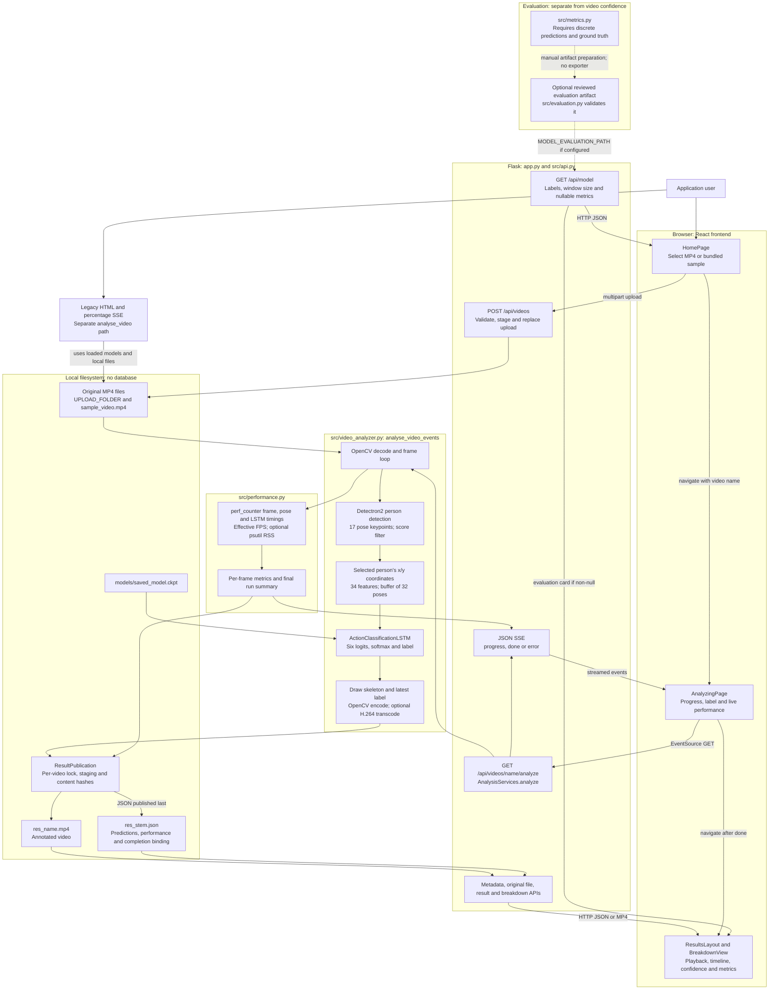
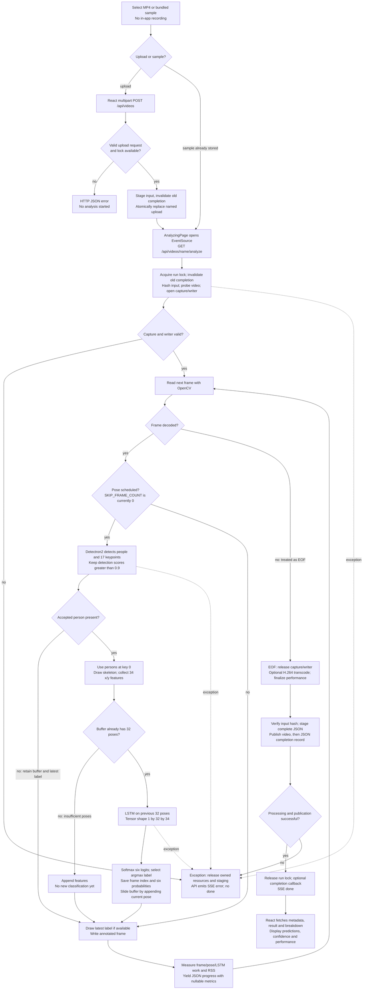
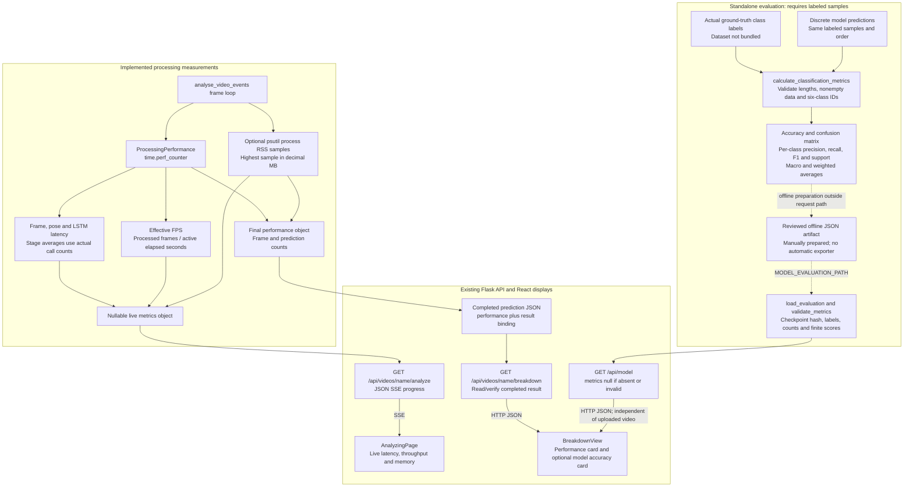
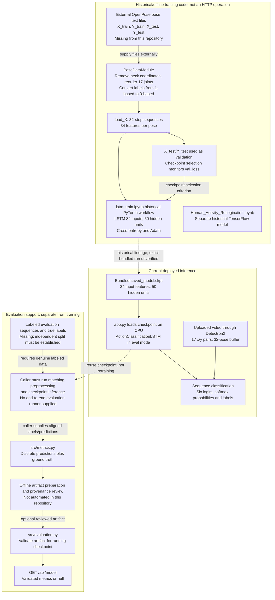
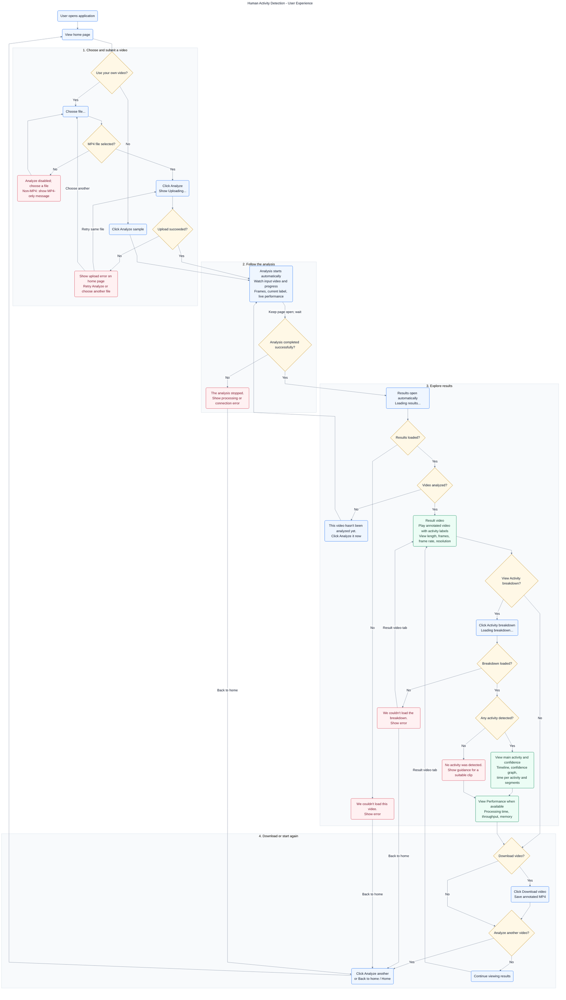

# CSCE 5214 — Human Activity Detection Architecture

## 1. Project Overview

**Course:** CSCE 5214 — Software Engineering for AI  
**Project:** Human Activity Detection Using Detectron2 and LSTM  
**Repository:** GroupProjectCSCE5014.400  
**Inspected branch:** `feature/backend-performance-metrics`  
**Source revision:** `7ead1b8` (working tree clean before creating this document).

The application classifies activities in an uploaded MP4 or the bundled sample video. React provides upload, progress, playback, and activity breakdown screens. Flask runs a Detectron2 pose detector and a PyTorch Lightning LSTM, writes annotated video and prediction data to local files, and streams processing progress through Server-Sent Events (SSE).

This is recorded-video processing. Progress and labels arrive while the server processes the file; there is no implemented camera recorder, webcam inference, or live camera stream. There is no application database, message broker, background job queue, or cloud storage integration in the inspected code.

The four diagrams below describe the current implementation. Solid arrows represent implemented calls or data flow. Dashed arrows identify offline/manual dependencies, optional configuration, or historical relationships; their labels state the limits. They do not imply an automated evaluation or training service.

## 2. Complete System Architecture

Visual exports: [Scalable SVG](diagrams/system-architecture.svg) · [High-resolution PNG](diagrams/system-architecture.png).

**Source basis:** [app.py](../app.py), [src/api.py](../src/api.py), [src/video_analyzer.py](../src/video_analyzer.py), [src/results.py](../src/results.py), and the [React pages](../frontend/src/pages/).

`app.py` creates Flask and loads models at import time. Detectron2 uses the model-zoo configuration `COCO-Keypoints/keypoint_rcnn_R_50_FPN_3x.yaml` and its checkpoint URL. It selects CUDA when available, otherwise CPU. The LSTM checkpoint is loaded on CPU with `weights_only=False`, then `.eval()` is called. These initialization operations happen before serving analysis requests, not once per frame.

`frontend/index.html` loads `src/main.tsx`, which mounts `App` inside `BrowserRouter`. React routes are `/`, `/analyzing/:video`, `/results/:video`, and `/results/:video/breakdown`. The API client uses `fetch` for JSON requests and `EventSource` for analysis. Entering the analyzing page starts analysis; there is no separate queued-job creation endpoint.

Vite uses React, TypeScript, and Tailwind. `frontend/package.json` specifies React 19, React Router 7, Vite 8, TypeScript 6, and Node `>=20.19`. During development, Vite proxies `/api` from port 5173 to Flask on port 5001. Flask serves `frontend/dist` when built; otherwise the page handler falls back to the legacy template. `HOST` and `PORT` override the default `127.0.0.1:5001`. The executable entry point uses Flask's development server with debug enabled and the reloader disabled; a production deployment topology is not implemented here.

## 3. Video Analysis Pipeline

Visual exports: [Scalable SVG](diagrams/video-processing-flow.svg) · [High-resolution PNG](diagrams/video-processing-flow.png).

The diagram expands [analyse_video_events()](../src/video_analyzer.py), not the separate legacy generator. It is synchronous work inside the streaming request. There is no worker service behind the endpoint.

Detectron2's predictor threshold is `0.5`; `find_person_indicies()` in [src/utils.py](../src/utils.py) then applies the stricter `score > 0.9` person filter. Keypoint confidence is not an LSTM feature. Inference uses the 17 pairs of raw pixel coordinates without normalization; the OpenPose-to-Detectron coordinate remapping belongs to the offline dataset loader, not this frame loop.

The first 32 accepted pose frames fill the buffer. The next accepted pose frame triggers classification of the preceding buffer before the current pose is appended. Thus the first prediction is on the 33rd accepted pose frame, and frame indices saved in JSON are zero-based. Progress `frame` counts processed frames after incrementing the counter. Missing detections do not clear the buffer or label, so a window can span gaps in the video and a previous label can remain on later frames without a fresh prediction. Videos with no predictions still produce processing summaries when the run completes successfully.

The deployed class order is fixed:

| Output index | Activity label |
|---|---|
| 0 | `JUMPING` |
| 1 | `JUMPING_JACKS` |
| 2 | `BOXING` |
| 3 | `WAVING_2HANDS` |
| 4 | `WAVING_1HAND` |
| 5 | `CLAPPING_HANDS` |

The LSTM returns one six-class output per input sequence, not a separate single-frame classifier or a whole-video accuracy score. `build_breakdown()` computes the main activity from segment durations. Confidence is the highest softmax probability; the confidence graph shows all six probabilities over video time. Neither is proof that the selected class is correct.

## 4. Backend Metrics Architecture

Visual exports: [Scalable SVG](diagrams/backend-metrics.svg) · [High-resolution PNG](diagrams/backend-metrics.png).

No arrow connects video confidence to classification evaluation. [src/metrics.py](../src/metrics.py) requires `y_true` and `y_pred`, accepts IDs `0–5` or exact class names, and rejects probability arrays. It returns fractional scores, six ordered per-class rows, support counts, and a confusion matrix whose rows are actual classes and columns are predictions. Macro averaging includes all six classes; weighted averaging uses actual class support. Undefined precision, recall, or F1 becomes zero.

[src/evaluation.py](../src/evaluation.py) loads only an explicitly configured artifact. It checks the current checkpoint hash, labels, window size, split/provenance fields, known schema fields, bounded counts, and score consistency with the confusion matrix. `AnalysisServices.model_metrics()` and the API retain the null fallback when evaluation is missing or invalid. These checks do not establish that submitted ground truth is genuine or that a split is independent. No real evaluation artifact was found in the inspected repository.

Processing field definitions follow [src/performance.py](../src/performance.py) and [API.md](API.md):

| Live / final field | Meaning |
|---|---|
| `frameMs` / `avgFrameMs` | Read/decode through annotated-frame write, in milliseconds; average over processed frames |
| `poseMs` / `avgPoseMs` | Detection, person filtering and keypoint transfer, in milliseconds; average over pose calls |
| `lstmMs` / `avgLstmMs` | LSTM forward, softmax and class selection, in milliseconds; average over predictions; tensor preparation is outside the stage |
| `fps` / `avgFps` | Cumulative effective processing throughput, not input playback FPS and not a rolling rate |
| `memoryMb` / `peakMemoryMb` | Sampled backend RSS in decimal MB; excludes GPU allocation and transcoder child-process memory |
| `totalS` | Active analysis seconds through encoding/transcoding; includes initial input hashing/probing but excludes final publication hashing, JSON serialization/publication, callback time and suspension at yield |
| `framesProcessed`, `predictionCount` | Actual processed frame count and LSTM classification count |

CUDA stages synchronize on the model's parameter device before/after timing. Unsupported or unavailable API measurements become `null`; React formatters display `—`. An absent LSTM measurement is not a zero-duration inference. Final FPS includes setup/finalization and therefore need not equal `1000 / avgFrameMs`.

## 5. Training and Evaluation Architecture

Visual exports: [Scalable SVG](diagrams/training-evaluation.svg) · [High-resolution PNG](diagrams/training-evaluation.png).

**Historical training:** the PyTorch notebook references `/content/RNN-HAR-2D-Pose-database/` and constructs `ActionClassificationLSTM(34, 50, ...)`. `PoseDataModule` groups rows into 32-step windows and uses `X_test.txt`/`Y_test.txt` for validation. `ModelCheckpoint` monitors `val_loss`. That split is therefore not automatically an untouched test set. The notebooks describe OpenPose poses derived from Berkeley MHAD; the underlying files and their split provenance are not locally available to verify.

**Training entry-point discrepancy:** [src/train.py](../src/train.py) currently constructs `ActionClassificationLSTM(WINDOW_SIZE, hidden_dim, ...)`, passing 32 as the input feature count instead of 34. This differs from the notebook and bundled checkpoint. Its historical Lightning trainer APIs and GPU-only training settings have not been validated in the current environment. The diagram is a description of the intended historical data relationship, not a claim that this script can currently reproduce the checkpoint.

**Deployed model:** checkpoint metadata was read using ZIP/pickle opcode inspection without deserializing or executing the checkpoint. Saved hyperparameters identify 34 input features and 50 hidden units; the saved Lightning version is 1.3.3 and the epoch is 392. The deployed class definition has one LSTM layer and a six-output linear layer using the final hidden state. Exact training-run provenance remains unverified. The separate TensorFlow notebook is not loaded by Flask.

**Evaluation:** metric computation and artifact validation are implemented. Acquiring data, running a full labeled evaluation, and exporting a reviewed artifact remain external/manual work. No training, retraining, or labeled model evaluation occurs during uploaded-video analysis or `/api/model` requests.

## 6. Component Responsibilities

| Component | Source file | Responsibility | Dependencies |
|---|---|---|---|
| Browser entry and routing | [main.tsx](../frontend/src/main.tsx), [App.tsx](../frontend/src/App.tsx) | Mount React and select home, progress and nested results views | React, React DOM, React Router |
| Upload and sample selection | [HomePage.tsx](../frontend/src/pages/HomePage.tsx) | Choose an MP4, submit upload, or analyze the existing sample | API client, browser file input |
| API client and state | [api.ts](../frontend/src/api.ts), [lib.ts](../frontend/src/lib.ts) | Typed JSON requests, EventSource, asynchronous state and number formatting | Fetch, EventSource, React hooks |
| Progress display | [AnalyzingPage.tsx](../frontend/src/pages/AnalyzingPage.tsx) | Show completion percentage, current label and live performance; navigate on done | API events and shared UI components |
| Results and breakdown | [ResultsPage.tsx](../frontend/src/pages/ResultsPage.tsx), [BreakdownPage.tsx](../frontend/src/pages/BreakdownPage.tsx) | Playback/download, segment timeline, six probability curves, durations, performance and optional evaluation card | API metadata, completed results, inline SVG |
| Shared UI | [components.tsx](../frontend/src/components.tsx), [index.css](../frontend/src/index.css) | Cards, navigation, legends, status messages and styling | React, Router, Tailwind |
| Frontend tooling | [vite.config.ts](../frontend/vite.config.ts), [package.json](../frontend/package.json), [tsconfig.json](../frontend/tsconfig.json) | Development API proxy, strict TypeScript and static bundle build | Vite, TypeScript, Tailwind, Node |
| Application composition | [app.py](../app.py) | Create Flask, load models, register API blueprint, expose legacy and static routes | Flask, Detectron2, torch, Lightning |
| JSON API and summaries | [src/api.py](../src/api.py) | Upload, probe, stream events, read results, compute breakdown and return model info | Injected AnalysisServices, Flask, results/evaluation helpers |
| Inference and media | [src/video_analyzer.py](../src/video_analyzer.py) | Probe/decode, detect poses, classify windows, annotate/encode, yield progress | OpenCV, NumPy, torch, loaded models; optional imageio-ffmpeg |
| Pose selection and rendering | [src/utils.py](../src/utils.py) | Filter person scores, transfer keypoints to CPU and draw skeletons | Detectron2 output instances, OpenCV |
| LSTM and data loader | [src/lstm.py](../src/lstm.py) | Define forward pass, pose text loading and historical training/validation hooks | torch, Lightning, torchmetrics, NumPy |
| Training entry point | [src/train.py](../src/train.py), [lstm_train.ipynb](../lstm_train.ipynb) | Historical training configuration and checkpoint selection; not called by API | PoseDataModule, Lightning callbacks, external data |
| Classification metrics | [src/metrics.py](../src/metrics.py) | Accuracy, precision, recall, F1, supports and ordered confusion matrix | scikit-learn; discrete labels and predictions |
| Processing measurements | [src/performance.py](../src/performance.py) | Accumulate timings/counts, pause during yields/callbacks, normalize nullable fields | Standard-library clock; optional psutil |
| Evaluation artifact validation | [src/evaluation.py](../src/evaluation.py) | Validate configured artifact identity, schema, bounded values and score arithmetic | JSON, hashlib; configured artifact and checkpoint |
| Result publication | [src/results.py](../src/results.py) | Lock operations, invalidate completion, stage files, bind hashes and verify results | Local filesystem, UUID, hashlib, atomic rename |
| Regression coverage | [tests/](../tests/) | Classification, processing, API, publication and validation tests | unittest, mocks, temporary fixtures |

## 7. API Endpoints

Routes below come from decorators in `src/api.py` and `app.py`. Ordinary JSON/media requests and the long-lived SSE analysis request are different interactions. See [API.md](API.md) for complete field definitions.

| Method | JSON API route | Purpose / response |
|---|---|---|
| GET | `/api/health` | `{"status":"ok"}`; models are already initialized by application startup |
| GET | `/api/model` | Ordered labels, `windowSize`, and validated evaluation `metrics` or null |
| GET | `/api/sample` | Metadata and analyzed status for `sample_video.mp4` |
| POST | `/api/videos` | Multipart field `video`; stage/save MP4; return `201 {"name":...}` |
| GET | `/api/videos/<name>` | Source FPS, frame count, dimensions, duration and verified analyzed status |
| GET | `/api/videos/<name>/file` | Original MP4 bytes |
| GET | `/api/videos/<name>/analyze` | Run analysis synchronously; `text/event-stream` containing JSON progress/done/error events |
| GET | `/api/videos/<name>/result` | Verified completed annotated MP4; `?download=1` requests attachment |
| GET | `/api/videos/<name>/breakdown` | Summary, segments, durations, per-prediction confidence/probabilities and optional stored performance |

JSON/SSE fields are additive: progress contains `type`, `percent`, `frame`, `totalFrames`, `label`, and `metrics`; terminal events use `type: done` or `type: error` plus `message`. A progress value of 100 does not certify publication. React waits for `done`, closes EventSource and requests results. Stream failures close owned generators/resources; the API formats an error event for caught exceptions. The error event currently includes `str(error)`.

Uploads enforce sanitized MP4 names, reserve the sample and `res_` names, and use Flask's configured request limit (`MAX_UPLOAD_MB`, default 200, multiplied by 1024 squared). Upload errors use JSON with 400/413, conflicting operations use 409, and I/O failures use 500. Metadata probing uses generic JSON errors: 422 for invalid metadata, 404 for disappearing input, and 500 for decoder/I/O failures. Results not ready or busy return 404; corrupt breakdown content returns a generic JSON 500 response.

| Method | App/static or legacy route | Implemented behavior |
|---|---|---|
| GET | `/`, `/analyzing/<path:_>`, `/results/<path:_>` | Serve built React index, or legacy fallback if no build exists |
| GET | `/assets/<path:filename>`, `/favicon.svg` | Serve built frontend assets |
| GET | `/legacy` | Render `templates/index.html` |
| POST | `/upload`, `/sample` | Legacy HTML upload/sample selection |
| GET | `/files/<filename>` | Legacy direct file serving from upload directory |
| GET | `/analyze/<filename>` | Legacy percentage-only SSE through `analyse_video()` |
| GET | `/result_video/<filename>` | Legacy multipart JPEG stream through `stream_video()` |
| GET | `/analyzed_files/<filename>` | Legacy direct annotated-video download |

The legacy path shares models and local output filenames but does not produce React prediction JSON, use `ResultPublication`, or apply the JSON API's completion/hash checks. Its output writer uses a fixed 30 FPS, whereas the React path uses probed input FPS. Optional legacy callbacks expose performance dictionaries without changing its percentage SSE format. These are separate code paths, not aliases for the JSON API.

## 8. Data Storage

`UPLOAD_FOLDER` is `./`, relative to the process working directory. The supplied run scripts change to the repository directory before starting Flask. React analysis writes outputs next to the resolved input path. No external database is used.

| Data | Actual location / form |
|---|---|
| Uploaded input | `<UPLOAD_FOLDER>/<secure filename>.mp4`; `res_upload_*` is a temporary upload file |
| Bundled example | `sample_video.mp4`; not accompanied by ground-truth labels |
| Annotated result | `res_<original name>.mp4`; H.264 if optional transcoding succeeds, otherwise OpenCV mp4v |
| Prediction JSON | `res_<input stem>.json`: `video`, `windowSize`, `predictions`, `performance`, `result` |
| Predictions | Rows containing zero-based `frame` and six class probabilities; derived labels/confidence are constructed by the breakdown API |
| Performance summary | `performance` inside the same prediction JSON, not a separate database/table/file |
| Completion metadata | `result` inside that JSON: `runId`, `inputSha256`, `videoSha256`; the JSON is the completion record |
| Per-run staging | `res_stage_<runId>_raw.mp4`, `res_stage_<runId>.mp4`, `res_stage_<runId>.json.tmp` |
| Operation lock | `res_<input stem>.lock`, acquired by exclusive file creation |
| LSTM checkpoint | `models/saved_model.ckpt` |
| Detectron2 weights | Model-zoo checkpoint URL configured in `app.py`; cache is managed by Detectron2, not a repository dataset |
| Optional evaluation artifact | File supplied through `MODEL_EVALUATION_PATH`; no artifact bundled |
| Training/evaluation datasets | Expected external pose text files; not present in the inspected tree |
| Historical plots | `images/val_acc.png`, `images/val_loss.png`; not verified current-checkpoint evaluation results |

`ResultPublication` invalidates only the relevant previous completion record, assigns a run ID, hashes the input, and owns unique staging paths. It verifies the input again, hashes the staged output, writes/flushes/fsyncs complete metadata, then renames the video and finally the JSON. These are two ordered filesystem operations, not a single atomic transaction covering both files. API visibility is gated by the final JSON and the lock. A failed metadata commit leaves the output unavailable through those API lookups, even if the video rename succeeded. Cleanup removes only owned staging files and releases the lock.

`read_result()` verifies the input/output hashes for bound records. Historical sidecars without bindings use modification-time checks instead. Replacement uploads invalidate the old record before replacing the source. Read/download handlers use the same verification boundary, but the separate legacy file routes do not.

## 9. Implemented vs. Planned Features

| Status | Feature |
|---|---|
| Implemented | Recorded MP4 upload, sample selection, progress SSE, six-class pose-sequence inference and annotated playback/download |
| Implemented | Activity timeline, per-class probability chart, segment table, durations, main activity and average confidence |
| Implemented | Frame/pose/LSTM timings, effective FPS, counts, nullable RSS measurements and persisted performance summaries |
| Implemented | Ground-truth-based metric function and reviewed-artifact validation; `/api/model` null fallback |
| Implemented | Per-video file locks, staged publication, completion invalidation and input/output binding on the React API path |
| UI scaffolding only | Optional `smoothedLabel`, live `confidence`, threshold and smoothing cards; the current backend does not emit smoothing or threshold decisions |
| Missing/external work | Labeled datasets, independent model evaluation, end-to-end evaluation runner and automated artifact export |
| Not implemented | In-app recording, live camera classification, multi-person tracking, new activity training through the UI, database, queue, cloud deployment or background evaluation service |
| Not verified here | Actual frontend build/rendering, real Detectron2/CUDA throughput, reproducibility of historical model training |

Differences from older documentation are material. `docs/ORIGINAL_README.md` describes a historical TensorFlow two-layer model and ngrok; these are not the current Flask runtime. The current README's “32 consecutive frames” wording simplifies a buffer that actually contains accepted poses and may span missing detections. Some frontend comments still call processing/model metrics “planned,” although these API fields and displays are now implemented. No pre-existing architecture diagram file was found or edited.

## 10. Known Limitations and Validation

- **Dataset availability and provenance:** no `X_train.txt`, `Y_train.txt`, `X_test.txt`, `Y_test.txt`, independent test split or genuine evaluation artifact is bundled. Historical dataset descriptions and plots are not a measured accuracy claim for the deployed checkpoint.
- **Single-person assumptions:** the frame loop uses `persons[0]`, while filtering returns a dictionary keyed by detection index. A retained detection with another key can trigger an error. There is no persistent person tracking or multi-person classifier.
- **Temporal interpretation:** windows can span missed detections. The latest label can persist without a new prediction. The model always selects one of six classes when inference runs; smoothing and an “uncertain” decision are not implemented.
- **Decode failure versus EOF:** a false return from `cap.read()` ends the loop. The code does not reliably distinguish mid-file decode failure from normal EOF, so a partial readable stream may complete.
- **Concurrency:** the React file lock protects one input's upload/analysis/result verification across processes. A second same-video operation fails rather than queues. Different videos may use the same global model objects concurrently; there is no model-wide scheduler or validated GPU concurrency policy. Legacy operations bypass these locks.
- **Failure/recovery:** abrupt process termination may leave a lock or staging files. Recovery requires checking the owning process; no automatic stale-lock removal is implemented. Windows downloads can prevent replacement of an open result file. Hash verification costs I/O proportional to video size.
- **Serving limits:** the legacy routes directly serve local files and do not share React completion validation. The system has no implemented authentication, durable job tracking or production WSGI deployment configuration.
- **Measurement limits:** RSS is sampled, not an exact memory high-water mark. It includes shared backend/model memory and excludes GPU/transcoder allocation. Synchronization and sampling add overhead; real GPU performance was not measured here.
- **Environment limits:** the initial architecture inspection found no Node/npm or Mermaid renderer. For the visual export task, portable Node.js 24.22.1, npm 11.19.1, Mermaid CLI 12.0.0 and its Chromium dependency were installed with approval in a temporary local tool directory, outside application dependencies. The frontend build and real model inference remain unverified; neither was started for diagram rendering.
- **Diagram validation:** all four Mermaid diagrams passed Mermaid CLI 12.0.0 parsing and rendered successfully to SVG and PNG using local headless Chromium. Exports use a white background, consistent category colors, wider labels and Mermaid's bundled ELK layout. The rendered images were visually reviewed; nodes, relationships and original Mermaid source blocks are preserved. PNGs are exported at 2x scale, up to 6,400 pixels on the longest side. SVGs remain scalable. Native GitHub preview was not separately tested.

Inspection covered the source/configuration files linked in sections 2–8, `templates/index.html`, the run scripts, `requirements-modern.txt`, the model directory and the PyTorch notebook's training cells. Checkpoint inspection was read-only metadata inspection. This document introduces no application, dataset, checkpoint or API changes.

## User Experience and Application Flow

This user flow describes the implemented React interface for the CSCE 5214 presentation. A person opens the home page, uploads an existing MP4 or chooses **Analyze sample**, follows processing progress, and receives the annotated result video automatically. **Activity breakdown** provides detected activities and confidence graphs; **Download video** saves the annotated MP4, and **Analyze another** returns home.

Diagram source: [user-flow.mmd](diagrams/user-flow.mmd). The identical source is embedded below for Mermaid-capable Markdown viewers. SVG/PNG exports are unavailable in this session: the existing Mermaid CLI could not find its expected Chromium runtime, and installed Chrome/Edge launch attempts failed. No software was installed.

The decisions below describe application states and user choices; they are not extra confirmation dialogs. Blue rounded nodes represent actions or screen states, amber diamonds represent decisions, green nodes represent results, and rose nodes represent errors or empty states. The source file and embedded diagram are identical.

### Major user actions and visible information

| Stage | Implemented interaction and display |
|---|---|
| Choose a source | **Choose file...** opens a file picker; the selected filename appears and the label becomes **Choose another file...**. Alternatively, **Analyze sample** uses the bundled sample without uploading. There is no recorder/source-selection dialog; the flow's source decision represents these two home-page cards. |
| Validate and submit | **Analyze** is disabled until a file with a case-insensitive `.mp4` filename suffix is selected, and while uploading. Other suffixes show **Only .mp4 files are supported**. Selecting a file alone does not start analysis. Clicking **Analyze** uploads it and shows **Uploading...**. This filename check does not verify that the video can be decoded. |
| Follow progress | A successful upload opens the analysis page; the sample opens it directly. Analysis starts on entering that page. The original video loops alongside a percentage, progress bar, analyzed/total frame counts, and the current activity label (initially **Waiting...**). The page asks users to keep it open. |
| View live performance | **Live performance** appears when measurements arrive: time per frame, throughput, pose detection time, LSTM inference time, and memory. Missing numerical values display a dash. Live confidence is optional UI scaffolding and is not emitted by the current backend. |
| Receive results | Navigation occurs on successful completion, not merely on reaching 100%. **Loading results...** precedes the **Result video** tab. Users can play the annotated video with skeleton and predicted activity, and inspect length, frame count, frame rate and resolution. |
| Explore details | **Activity breakdown** loads main activity/share, label changes, average confidence, prediction count, activity timeline, per-class **Confidence over time**, time per activity, and segment average/peak confidence. The current display names are Jumping, Jumping jacks, Boxing, Waving (2 hands), Waving (1 hand), and Clapping hands. |
| Inspect final performance | **Performance** in the breakdown shows whole-video processing time, average frame/pose/LSTM times, average throughput and peak memory when a performance record exists. It also appears in the no-predictions view. These measurements describe processing, not model accuracy. |
| Download or navigate | **Download video** and **Analyze another** remain in the shared results header on both tabs, including breakdown loading/error/empty states. Users can switch between **Result video** and **Activity breakdown** repeatedly. The diagram places download after viewing for readability; viewing details is not required to download. **Home**, the application logo, and **New analysis** also return home. Navigating home is not a dedicated cancel-job control or a promise of resumable processing. |

### User-visible errors and recovery

- **No selection or wrong suffix:** Analyze stays disabled. A non-MP4 selection shows the MP4-only message; choose a suitable file. Other video problems can surface during processing rather than selection.
- **Upload failure:** the home-page upload card displays the API error, or `Request failed (status)` if no JSON error is available. Analyze becomes enabled again and the selected file remains, so users can retry it or choose another file. Server validation, size-limit, conflict and storage errors all follow this path; the default server upload limit is 200 MB and is configurable, not a client-side size check.
- **Processing or connection failure:** **The analysis stopped.** displays the error and **Back to home**. A lost stream reports **Lost connection to the server while analyzing.** The stream closes; there is no automatic reconnect or Retry button. Return home to submit a file again or use the sample.
- **Result metadata failure:** **We couldn't load this video.** shows the error and **Back to home**. If metadata loads but the video is not analyzed, **This video hasn't been analyzed yet.** offers **Analyze it now**, which starts processing again. This is particularly relevant when opening a results URL directly.
- **Breakdown failure:** **We couldn't load the breakdown.** shows the error and **Back to home**. The shared results header and tabs remain available, so users can return to **Result video**, download, or analyze another clip. There is no dedicated breakdown Retry button.
- **No predictions:** **No activity was detected.** gives guidance to use one person with the whole body visible for at least 32 frames. Performance and optional model evaluation cards may still appear. This is an empty result, not a failed analysis; playback/download and navigation remain available. Inference actually needs enough accepted poses, so 32 video frames alone do not guarantee a prediction.
- **Other navigation/media limits:** unknown routes show **Page not found.** with a home link. Video playback and download use native browser behavior; the application has no custom playback/download error or retry panel. These secondary paths are described here to keep the diagram readable.

### Planned and conditional features

In-app video recording and live camera classification are not implemented. Smoothing, majority voting, confidence thresholds, an Uncertain label and live confidence are planned backend features with conditional frontend displays; they are not included as completed user actions in the flow.

The **Model accuracy** card is implemented but conditional on a valid, reviewed offline evaluation artifact. No such artifact is bundled, so the normal response has `metrics: null` and the card is hidden. When configured, it shows accuracy, precision, recall, F1, per-class metrics and a confusion matrix. Uploaded-video confidence scores do not establish model accuracy. Performance measurements, unlike smoothing, are implemented despite stale planned comments in `api.ts`.

### Inspection and validation

The flow was checked against [App.tsx](../frontend/src/App.tsx), [HomePage.tsx](../frontend/src/pages/HomePage.tsx), [AnalyzingPage.tsx](../frontend/src/pages/AnalyzingPage.tsx), [ResultsPage.tsx](../frontend/src/pages/ResultsPage.tsx), [BreakdownPage.tsx](../frontend/src/pages/BreakdownPage.tsx), [api.ts](../frontend/src/api.ts), [lib.ts](../frontend/src/lib.ts), [components.tsx](../frontend/src/components.tsx), and [API.md](API.md) on `feature/backend-performance-metrics`. Existing architecture sections and diagrams are preserved. No application code, endpoints, datasets or checkpoints were modified.

Mermaid CLI 12.0.0's installed Mermaid parser accepted the source as `flowchart-v2`. Parser-only validation preserved label text with a no-op sanitizer because Node has no browser DOM; no HTML was evaluated or rendered. Graph checks verified all 11 decisions have Yes/No branches, all 32 workflow nodes are reachable, and no workflow node is a dead end. Source/Markdown equality and preservation of the original architecture content were checked. Rendering and visual layout remain unverified because a working browser renderer was unavailable; the React app and model inference were not run for this documentation-only change.
